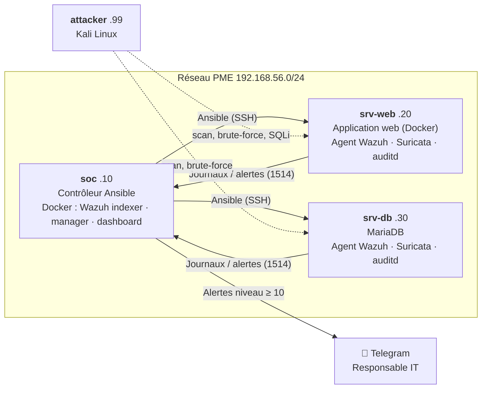

# HardenWatch

**Plateforme automatisée de durcissement et de supervision de la sécurité du SI d'une PME**

Projet de fin d'études — Licence Cybersécurité, IPNET Institute of Technology (Lomé)

> *Conception et déploiement d'une plateforme automatisée de durcissement et de supervision de la sécurité du système d'information d'une PME : cas pratique avec Ansible, Docker et Wazuh*

---

## Le problème

Les PME togolaises (cabinets, microfinances, commerces, écoles…) exploitent des serveurs **configurés par défaut** et **sans aucune surveillance** : mots de passe faibles, SSH ouvert à root, aucun pare-feu, aucune trace des attaques. Elles n'ont ni budget pour un SOC commercial, ni équipe sécurité dédiée.

## La solution

HardenWatch combine deux briques **open source, gratuites et automatisées** :

| Brique | Rôle | Outils |
|---|---|---|
| **Harden** — durcir | Appliquer en une commande les bonnes pratiques CIS Benchmark / ISO 27001 sur tout le parc, et **mesurer** le gain | Ansible, Lynis, Wazuh SCA |
| **Watch** — surveiller | Détecter les attaques en temps réel, alerter sur Telegram, bloquer automatiquement | Wazuh (SIEM/XDR), Suricata (IDS), Docker |

## Architecture



Détails : [docs/architecture.md](docs/architecture.md)

## Démarrage rapide

Prérequis : PC 64 bits, **16 Go de RAM**, VirtualBox 7 et Vagrant installés.

Sur le PC :

```bash
vagrant up
```

Ensuite, dans la VM soc :

```bash
vagrant ssh soc
```

```bash
cd /vagrant && make deploy
```

Tableau de bord Wazuh : **https://localhost:8443** (lab : `admin` / `SecretPassword`).

## Scénario de démonstration

| Étape | Commande | Ce que l'on montre |
|---|---|---|
| 1. PME vulnérable | `make deploy` | Serveurs mal configurés, mais déjà surveillés |
| 2. Mesure initiale | `make audit-avant` | Score Lynis faible, conformité CIS faible dans Wazuh |
| 3. Attaques | depuis Kali | Scan, brute-force, injection SQL → détectés, alerte Telegram, IP bloquée |
| 4. Durcissement | `make durcir` | Une commande sécurise tout le parc |
| 5. Mesure finale | `make audit-apres` puis `make scores` | Le score augmente, les attaques échouent |


## Organisation du dépôt

```
├── Vagrantfile              # Les 4 machines virtuelles du lab
├── Makefile                 # Raccourcis : make deploy / audit-avant / durcir / audit-apres
├── scripts/                 # Préparation initiale des VM
├── ansible/
│   ├── inventory/           # Machines et variables (ports ouverts, options…)
│   ├── playbooks/           # Étapes du déploiement (00 → 60)
│   └── roles/
│       ├── baseline_vulnerable/  # Simule la PME "avant" (lab uniquement !)
│       ├── common/ docker/       # Socle
│       ├── wazuh_soc/            # SOC Wazuh sous Docker + Telegram + réponse active
│       ├── wazuh_agent/ suricata/# Collecte et détection sur les serveurs
│       ├── services_metier/      # Application web (Docker) et base de données
│       ├── hardening/            # ⭐ Durcissement CIS / ISO 27001
│       └── lynis_audit/          # Mesure du niveau de sécurité
├── reports/                 # Rapports d'audit avant/après + scores.csv
└── docs/                    # Documentation technique
```

## Documentation

- [Architecture technique](docs/architecture.md)

## ⚠️ Avertissement

Le rôle `baseline_vulnerable` et l'application DVWA rendent **volontairement** les machines vulnérables. À n'utiliser que dans le réseau privé isolé du lab. Les attaques de démonstration ne doivent viser **que** les machines du lab (loi togolaise n°2018-026 sur la cybersécurité et la lutte contre la cybercriminalité).
