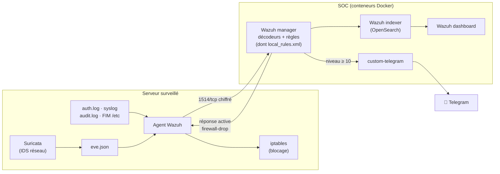

# Architecture technique

## 1. Vue d'ensemble

HardenWatch reproduit le SI minimal d'une PME : un serveur web, un serveur de base de données, et ajoute un **serveur SOC** qui pilote la sécurité de l'ensemble.

| Machine | IP | OS | RAM | Rôle |
|---|---|---|---|---|
| `soc` | 192.168.56.10 | Ubuntu 22.04 | 6 Go | Contrôleur Ansible + SOC Wazuh (Docker) |
| `srv-web` | 192.168.56.20 | Ubuntu 22.04 | 1 Go | Application web de la PME (Docker) |
| `srv-db` | 192.168.56.30 | Ubuntu 22.04 | 1 Go | Base de données MariaDB |
| `attacker` | 192.168.56.99 | Kali Linux | 2 Go | Simulation d'attaques (optionnelle) |

## 2. Flux réseau

| Source | Destination | Port | Usage |
|---|---|---|---|
| soc | serveurs | 22/tcp | Ansible (SSH par clé) |
| serveurs | soc | 1514/tcp | Remontée des événements des agents Wazuh |
| serveurs | soc | 1515/tcp | Enrôlement des agents |
| poste admin | soc | 443/tcp | Tableau de bord Wazuh (HTTPS) |
| soc | api.telegram.org | 443/tcp | Notifications |
| clients | srv-web | 80/tcp | Application web |
| srv-web | srv-db | 3306/tcp | Base de données (seul flux autorisé vers srv-db) |

Après durcissement, **tout autre flux entrant est refusé** par UFW.

## 3. Brique « Watch » : la chaîne de détection

1. **Collecte** : l'agent Wazuh lit les journaux système, les alertes Suricata (`eve.json`), les événements auditd, et surveille l'intégrité des fichiers de `/etc` en temps réel.
2. **Analyse** : le manager applique ses milliers de règles natives plus les règles HardenWatch (`ansible/roles/wazuh_soc/files/local_rules.xml`), avec correspondance MITRE ATT&CK.
3. **Visualisation** : l'indexer stocke, le dashboard affiche (événements, MITRE, conformité, vulnérabilités).
4. **Notification** : toute alerte de niveau ≥ 10 est envoyée sur Telegram.
5. **Réponse active** : un brute-force SSH (règles 5712/5763) entraîne le blocage de l'IP source pendant 10 minutes.

### Règles de détection propres au projet

| ID | Outil | Détecte |
|---|---|---|
| sid 9000001 | Suricata | Scan de ports (≥ 30 SYN en 10 s) |
| sid 9000002 | Suricata | Connexions SSH répétées (≥ 10 en 60 s) |
| sid 9000003 | Suricata | Injection SQL `UNION SELECT` dans une URL |
| sid 9000004 | Suricata | Outils d'attaque (sqlmap, nikto, nmap, hydra) |
| 100100 | Wazuh | Élève les alertes Suricata HardenWatch au niveau 10 |
| 100110 | Wazuh | Modification de `/etc/passwd`, `/etc/shadow`, sudoers |

## 4. Brique « Harden » : le durcissement

Le rôle Ansible `hardening` applique, de façon **idempotente** (relançable sans effet de bord), les mesures suivantes :

| Domaine | Mesures | CIS Ubuntu 22.04 | ISO 27001:2022 |
|---|---|---|---|
| Mises à jour | unattended-upgrades | 1.9 | A.8.8 |
| Surface d'attaque | Suppression telnet/rsh/ftp…, modules noyau inutiles, pas de core dump | 1.1, 1.5, 2.x | A.8.9 |
| Réseau / noyau | sysctl : redirections ICMP, source routing, SYN cookies, ASLR… | 1.5, 3.3 | A.8.20 |
| Pare-feu | UFW : refus par défaut, ports autorisés par machine | 3.5 | A.8.20 |
| SSH | Pas de root, pas de mot de passe, 3 essais max, algorithmes modernes, fail2ban | 5.2 | A.8.5 |
| Comptes | Mots de passe ≥ 12 caractères / 3 classes, expiration 90 j, root et comptes à risque verrouillés | 5.4, 5.5 | A.5.17, A.8.2 |
| Traçabilité | auditd : comptes, sudoers, SSH, commandes root, heure système | 4.1 | A.8.15 |
| Permissions | /etc/shadow, crontab, répertoires cron | 6.1 | A.8.3 |
| Information légale | Bannière de connexion | 1.7 | A.5.10 |

### Mesure du résultat

Deux indicateurs indépendants :
- **Lynis** : indice de durcissement /100 par machine, historisé dans `reports/scores.csv`.
- **Wazuh SCA** (Security Configuration Assessment) : pourcentage de conformité au CIS Benchmark, visible en continu dans le tableau de bord (*Configuration Assessment*).

## 5. Pourquoi Docker et Ansible ?

| | Sans | Avec |
|---|---|---|
| **Ansible** | Configuration manuelle serveur par serveur, oublis, écarts | Toute la sécurité décrite dans des fichiers versionnés, appliquée en une commande à 3 ou 300 serveurs, relançable pour corriger les dérives |
| **Docker** | Installation lourde de la pile Wazuh (Java, OpenSearch, certificats) | Pile SOC complète démarrée en quelques minutes, isolée, version figée, facile à mettre à jour |

## 6. Passage en production (perspectives)

- Remplacer les VM Vagrant par de vraies machines ou des VM **Azure** (lien AZ-104 / AZ-500) : seul `inventory/hosts.yml` change.
- Changer les mots de passe par défaut de Wazuh et chiffrer les secrets avec **Ansible Vault**.
- Ajouter des postes **Windows** (agent Wazuh + durcissement via GPO ou Ansible WinRM).
- Mettre le dépôt dans une chaîne CI qui vérifie les playbooks (`ansible-lint`) à chaque modification.
